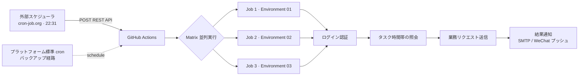

# キャンパスサービス向け定期タスク自動化・マルチアカウント運用の実践

**言語 / Language：** [中文](README.zh.md) · [日本語](README.md)

> キャンパスサービス向け「定期タスクの信頼性」と「マルチテナント設定管理」をテーマにした個人エンジニアリングプロジェクト。
> 技術スタック：Python 3.11 · requests · pycryptodome · GitHub Actions · 外部 Cron スケジューラ

---

## プロジェクト背景

あるキャンパスサービス（モバイル向けミニアプリ）では、毎日決まった時間帯（22:30–23:00）に一度だけ処理を実行する必要があり、その処理は Bluetooth デバイスの識別子と位置情報ゾーンに依存しています。

プラットフォーム側は公開 API ドキュメントも公式のスケジュール機能も提供していません。本プロジェクトの目的は「チェックイン用ツールを作ること」ではなく、この実務的な制約を題材に次の 3 つのエンジニアリング課題を解決することにあります。

1. **プロトコル層**：ドキュメントがない状態でパケットキャプチャからクライアントのリクエストを復元し、認証と業務 API の呼び出しを成立させる
2. **スケジューラ層**：ホスティングプラットフォームの定期実行が信頼できない場合に、代替となる高精度スケジューリングを設計する
3. **設定層**：マルチアカウント環境での認証情報の分離、並列実行、障害の局所化

> 注：本リポジトリには実際のアカウント・パスワード・トークンは含まれていません。設定例はすべてプレースホルダーです。

---

## システム構成



**設計方針**：業務実行とスケジューリングを分離しています。スケジューラ層はいつでも差し替え可能（プラットフォーム cron / 外部 cron / ローカルジョブ）で、業務層は 1 回の HTTP トリガーだけに依存します。

---

## 主要な実装

### 1. ドキュメントのない API のプロトコル復元

プロキシツールでクライアントのリクエストを取得し、呼び出しチェーン全体を復元しました。

| 工程 | 実装方法 |
| --- | --- |
| 認証 | `AES-ECB` でパスワードを暗号化。鍵はアカウント名を固定長まで埋め、先頭 16 文字を使用 |
| セッション | ログイン時に複数の Cookie が返る。**ルーティング用 Cookie が欠けると `103 未登录` になる** |
| 照会 | `GET /dormSign/mobile/receive/getMySignLogs` でタスクとデバイス識別子を取得 |
| 送信 | `POST /dormSign/mobile/receive/doSignByDevice`。ペイロードにデバイス UUID と部屋番号を連結 |

セッション管理は `requests.Session` に統一し、Cookie の手組みによる認証失敗を排除しました。

### 2. スケジューラの信頼性：プラットフォーム標準 cron を採用しなかった理由

実測では、プラットフォーム標準の `schedule` に **5〜30 分の制御不能な遅延**が発生しました。業務の時間帯は 30 分しかないため、遅延はそのまま実行機会の喪失につながります。

| 方式 | トリガー精度 | 信頼性 | コスト |
| --- | --- | --- | --- |
| プラットフォーム標準 cron | 5〜30 分の遅延 | 低 | 無料 |
| 事前起動＋ポーリング待機 | 起動遅延の影響を受ける | 中 | 1 回あたり約 10 分を余分に消費 |
| **外部スケジューラから REST API 呼び出し** | **秒単位** | **高** | 無料（トークンの托管が必要） |

最終的に 3 番目を採用し、標準 cron はフォールバックとして残しました。**2 経路からのトリガーは冪等**で、重複実行は業務層が「実行済み」と判定して安全に終了します。

### 3. マルチアカウントの並列実行と設定分離

当初はアカウントごとにジョブ定義を丸ごと複製しており、1 人追加するたびに 20 行の YAML をコピーする必要があり、ミスが起きやすい状態でした。GitHub Actions の `matrix` と `environment` で再構成しました。

```yaml
strategy:
  fail-fast: false          # 1 アカウントの失敗が他に波及しない
  matrix:
    environment: [CONFIG_01, CONFIG_02, CONFIG_03]
environment: ${{ matrix.environment }}
```

結果として、**アカウント追加のコストが「20 行の複製」から「リストに 1 項追加」へ**削減され、認証情報は Environment Secrets によって自然に分離され、相互に参照できなくなりました。

### 4. 障害の可観測性

初期実装では、API が `500` を返した際にその結果を「本日タスクなし」として扱ってしまい、タイムアウト後に**サイレントに失敗**していました。これは最も調査が難しい種類のバグです。

改善内容：

- 「照会失敗」と「本当にタスクなし」を明確に区別
- 連続失敗回数をカウントし、閾値超過時はサイレント終了ではなく能動的に警告
- 通知内容を構造化（アカウント・クラス・部屋・時間帯・サーバー応答の原文）
- 通知失敗時は 3 回自動リトライし、かつ主処理の終了コードには影響させない

### 5. 実行環境の差異によるハマりどころ

| 問題 | 症状 | 対策 |
| --- | --- | --- |
| タイムゾーン | ホスティング環境が UTC のため、ログ時刻と業務時間帯がずれる | UTC+8 に換算して表示し、業務判定はすべてタイムスタンプで実施 |
| 出力バッファリング | ログが長時間空のままになり、ハングと誤認 | `python -u` と `PYTHONUNBUFFERED` を併用 |
| 依存設定の欠落 | 環境変数未設定時に `KeyError` で即クラッシュ | 設定読み込みをデフォルト値付きのラッパーに統一 |

---

## 定量的な成果

| 指標 | 改善前 | 改善後 |
| --- | --- | --- |
| トリガー精度 | 5〜30 分の遅延 | 秒単位（実測 1.6 秒でトリガー完了） |
| 1 回の実行時間 | — | 約 40 秒（依存インストール含む） |
| アカウント追加コスト | YAML 20 行の複製 | 設定リストに 1 項追加 |
| 障害の可視性 | サイレントなタイムアウト | 能動的な警告＋構造化ログ |
| 認証情報の分離 | 平文の設定ファイル | Environment Secrets による分離 |

---

## ディレクトリ構成

```
.
├── actionVersion.py          # メイン処理：認証、タスク照会、送信、通知
├── requirements.txt          # 依存パッケージ
├── .github/workflows/
│   └── punch.yml             # スケジュールとマルチアカウントの matrix 定義
└── config.local.example.json # ローカル実行用の設定テンプレート（実認証情報なし）
```

---

## ローカル実行

```bash
pip install -r requirements.txt
cp config.local.example.json config.local.json   # プレースホルダーを埋める
python -u actionVersion.py
```

`config.local.json` は `.gitignore` で除外されており、バージョン管理には入りません。

---

## 振り返りと制約

- **プロトコルの安定性は上流依存**：API ドメイン、暗号化方式、デバイス識別子の仕様は変更され得るため、自動追従はできず人手での追随が必要です。これはリバースエンジニアリングに基づく手法に共通するコストです
- **スケジューラが外部依存を導入する**：外部 Cron サービスが停止した場合はバックアップ経路に依存するため、リスクの「低減」であって「排除」ではありません
- **通知の到達率は制御できない**：メール事業者のスパム判定や「自分自身への送信」制限が影響します。本番品質を目指すなら専用の通知サービスを導入すべきです
- **ユニットテスト未整備**：業務ロジックとネットワーク I/O が強結合しています。リファクタリング時はまず純粋関数層を抽出してからテストを追加すべきです

---

## 免責事項

本プロジェクトは個人の技術学習を目的としたもので、定期タスクの信頼性、プロトコル解析、マルチテナント設定管理の研究を目的としています。リポジトリには実際のアカウント、パスワード、トークン、個人情報は含まれておらず、認証情報を提供するものでもありません。

所属機関の規則に反する用途には使用しないでください。
