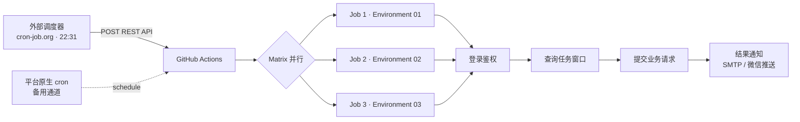

# 校园服务定时任务自动化 · 多账号调度实践

**语言 / Language：** [中文](README.zh.md) · [日本語](README.md)

> 一个围绕「定时任务可靠性」与「多租户配置管理」的个人工程实践项目。
> 技术栈：Python 3.11 · requests · pycryptodome · GitHub Actions · 外部 Cron 调度


---

## 项目背景

某校园服务（移动端小程序）的日常流程需要在固定时间窗内（每日 22:30–23:00）完成一次操作，且操作依赖蓝牙设备指纹与位置区域数据。

平台未提供公开 API 文档，也未提供官方定时能力。本项目的目标不是「做一个签到工具」，而是借这个真实场景解决三类工程问题：

1. **协议层**：在没有文档的前提下，通过抓包还原客户端请求，完成鉴权与业务接口的调用
2. **调度层**：在托管平台的定时能力不可靠时，设计可替代的精确调度方案
3. **配置层**：多账号场景下的凭据隔离、并行执行与故障隔离

> 说明：仓库内不含任何真实账号、密码或令牌；示例配置均为占位符。

---

## 系统架构



**设计要点**：业务执行与调度解耦。调度层可以随时替换（平台 cron / 外部 cron / 本地计划任务），业务层只依赖一次 HTTP 触发。

---

## 关键技术实现

### 1. 无文档接口的协议还原

通过代理工具抓取客户端请求，还原出完整调用链：

| 环节 | 实现方式 |
| --- | --- |
| 鉴权 | `AES-ECB` 加密密码，密钥由账号补齐定长后截取 |
| 会话 | 登录返回多个 Cookie，其中**路由 Cookie 缺失会导致 `103 未登录`** |
| 查询 | `GET /dormSign/mobile/receive/getMySignLogs` 获取任务与设备指纹 |
| 提交 | `POST /dormSign/mobile/receive/doSignByDevice`，载荷需拼接设备 UUID 与房间号 |

用 `requests.Session` 统一管理会话，避免手工拼装 Cookie 导致的鉴权失败。

### 2. 调度可靠性：为什么放弃平台原生 cron

平台原生的 `schedule` 在实测中存在 **5–30 分钟不可控延迟**，而业务时间窗只有 30 分钟，延迟直接导致错过。

方案对比：

| 方案 | 触发精度 | 可靠性 | 成本 |
| --- | --- | --- | --- |
| 平台原生 cron | 5–30 分钟延迟 | 低 | 免费 |
| 提前触发 + 脚本轮询等待 | 受启动延迟影响 | 中 | 每次多消耗约 10 分钟额度 |
| **外部调度器调用 REST API** | **秒级** | **高** | 免费（需托管 Token） |

最终采用第三方案，同时保留原生 cron 作为降级备份。**双通道触发是幂等的**——重复执行会被业务层识别为「已完成」并安全退出。

### 3. 多账号并行与配置隔离

最初每个账号复制一整段 job 定义，新增一人要复制 20 行 YAML，极易出错。重构为 GitHub Actions 的 `matrix` + `environment`：

```yaml
strategy:
  fail-fast: false          # 单账号失败不影响其他账号
  matrix:
    environment: [CONFIG_01, CONFIG_02, CONFIG_03]
environment: ${{ matrix.environment }}
```

效果：**新增账号从「复制 20 行」变为「列表加 1 项」**，凭据由 Environment Secrets 天然隔离，互相不可见。

### 4. 故障可观测性

早期版本在接口返回 `500` 时把结果当成「今日无任务」，导致超时后**静默失败**——最难排查的一类 bug。

改进措施：

- 区分「查询失败」与「确实无任务」两种状态
- 连续失败计数，超过阈值时主动告警而非静默退出
- 通知内容结构化（账号、班级、房间、时间窗、服务端返回原文）
- 通知失败自动重试 3 次，且不影响主流程退出码

### 5. 运行环境差异的坑

| 问题 | 现象 | 解法 |
| --- | --- | --- |
| 时区 | 托管环境为 UTC，日志时间与业务时间窗错位 | 固定用 UTC+8 换算后展示，业务判断全部基于时间戳 |
| 输出缓冲 | 日志长时间空白，误判为卡死 | `python -u` + `PYTHONUNBUFFERED` |
| 依赖缺失 | 环境变量未配置时 `KeyError` 直接崩溃 | 配置读取统一走带默认值的封装层 |

---

## 量化结果

| 指标 | 改进前 | 改进后 |
| --- | --- | --- |
| 调度触发精度 | 5–30 分钟延迟 | 秒级（实测 1.6s 完成触发） |
| 单次任务耗时 | — | 约 40 秒（含依赖安装） |
| 新增账号成本 | 复制 20 行 YAML | 配置列表加 1 项 |
| 失败可观测性 | 静默超时 | 主动告警 + 结构化日志 |
| 凭据隔离 | 明文配置文件 | Environment Secrets 隔离 |

---

## 目录结构

```
.
├── actionVersion.py          # 主流程：鉴权、任务查询、提交、通知
├── requirements.txt          # 依赖清单
├── .github/workflows/
│   └── punch.yml             # 调度与多账号矩阵定义
└── config.local.example.json # 本地调试配置模板（不含真实凭据）
```

---

## 本地运行

```bash
pip install -r requirements.txt
cp config.local.example.json config.local.json   # 填入占位符
python -u actionVersion.py
```

`config.local.json` 已被 `.gitignore` 排除，不会进入版本库。

---

## 反思与局限

- **协议稳定性依赖上游**：接口域名、加密方式、设备指纹规则都可能变更，脚本不具备自动适配能力，需要人工跟进——这是所有逆向方案的固有成本
- **调度器引入了外部依赖**：外部 Cron 服务不可用时依赖备份通道，属降级设计而非消除风险
- **通知渠道的到达率不可控**：邮件服务商的反垃圾策略、自发自收限制都会影响送达，生产级方案应引入专门的通知服务
- **未做单元测试**：业务逻辑与网络 I/O 强耦合，重构时应先抽象出纯函数层再补测试

---

## 声明

本项目为个人技术练习，用于研究定时任务可靠性、协议分析与多租户配置管理。仓库不含任何真实账号、密码、令牌或个人信息，也不提供任何凭据。

请勿将本项目用于违反所在机构规定的用途。
